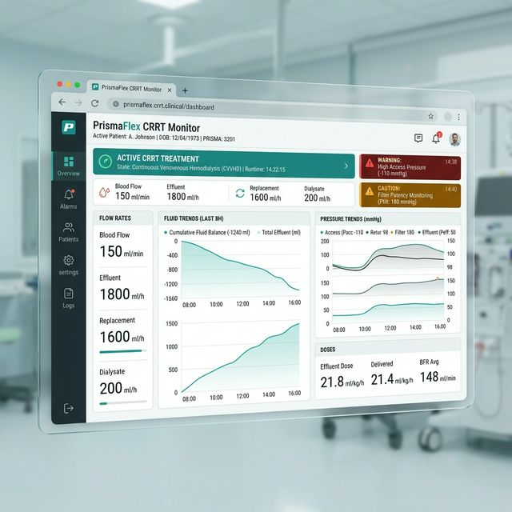
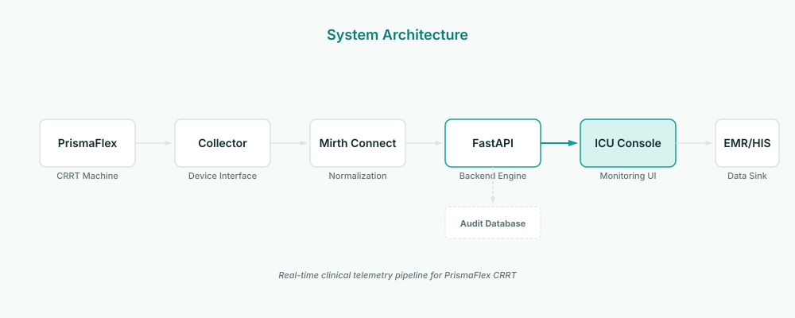
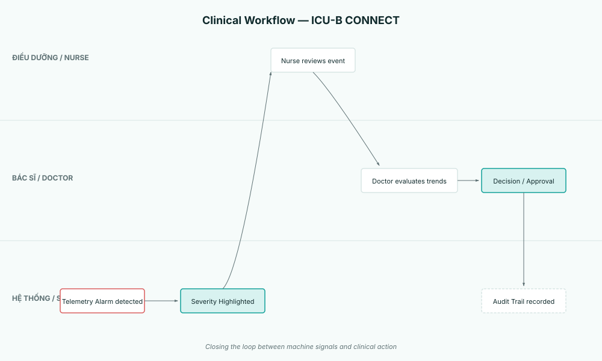
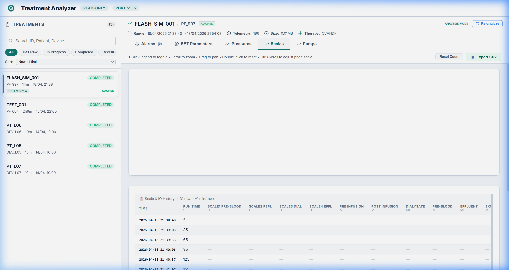
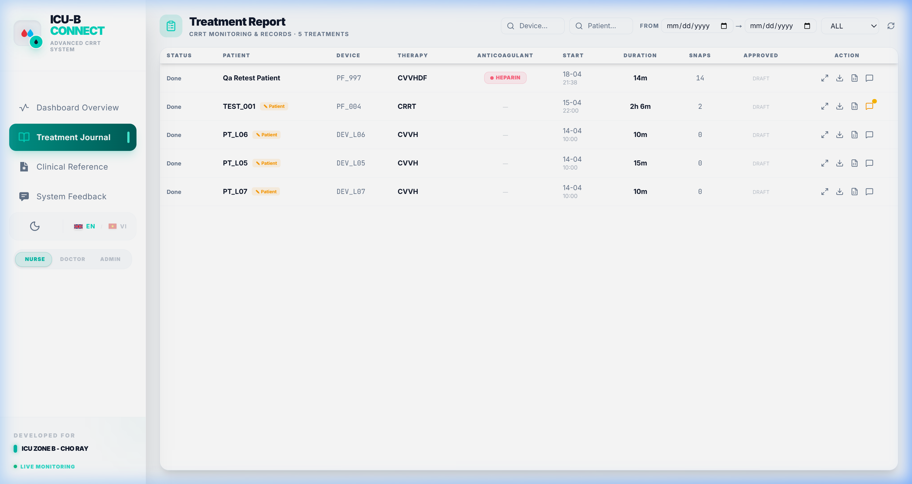

# ICU-B Connect — Real-Time ICU Telemetry & CRRT Clinical Dashboard

Web platform and architectural specification for real-time telemetry, alarm triage, and clinical decision support for Baxter Prismaflex Continuous Renal Replacement Therapy (CRRT) machines in Intensive Care Units (ICU).


---

## Clinical Telemetry Interface

The web interface centralizes telemetry from isolated dialysis machines at patient bedsides into a unified clinical workstation dashboard. Clinicians monitor transmembrane pressure (TMP), filter clotting indicators, fluid balance, and alarm states in real time.

<div align="center">
  
</div>

---

## 3-Tier Telemetry Architecture


1. **Edge Acquisition (Tier 1)**: Hardware interface connected to the Prismaflex serial diagnostic port. Captures raw flow rates, pressure sensor readings (arterial, venous, pre-filter, effluent), and machine alert states.
2. **Integration Bridge (Tier 2)**: Mirth Connect channel broker standardizing edge frames into validated HL7/JSON clinical structures across protected hospital network segments.
3. **Clinical Presentation (Tier 3)**: Next.js App Router application delivering responsive vitals curves, threshold notifications, and treatment history to nursing stations and attending physicians.

<div align="center">
  
</div>

---

## Clinical Workflow & Decision Support

The platform models the complete bedside care pathway: raw machine telemetry is analyzed for physiological anomalies, presented for nurse review, validated by intensive care physicians, and archived into clinical records.

<div align="center">
  
</div>

---

## Deep Analytics & Treatment Verification

<table width="100%">
  <tr>
    <td width="50%" align="center">
      <b>Treatment Analyzer & Pressure Waveforms</b><br/>
      
    </td>
    <td width="50%" align="center">
      <b>Clinical Review & Event Journal</b><br/>
      
    </td>
  </tr>
</table>

---

## Safety & Compliance Disclosure

- **Privacy Guaranteed**: This repository contains strictly simulated, de-identified parameters and synthetic waveforms. Zero Protected Health Information (PHI) or hospital identifiers are retained or transmitted.
- **Independent Interface**: Designed as an auxiliary monitoring and telemetry viewer to assist medical staff; never alters active dialysis pump settings or replaces primary bedside machine alarms.

---

## Getting Started

### Prerequisites

- Node.js 18.17 or higher
- npm or pnpm

### Installation & Local Run

```bash
git clone https://github.com/DinhLucent/ICURealtimeConnect_PrismaFlexOption.git
cd ICURealtimeConnect_PrismaFlexOption
npm install
npm run dev
```

Open [http://localhost:3000](http://localhost:3000) in your browser.

### Production Static Export

```bash
npm run build
```

Generates a static web bundle in `out/`, pre-configured for automated deployment via GitHub Actions (`.github/workflows/deploy-pages.yml`) or Vercel.

---

## License

MIT License. Copyright (c) 2022-present Đinh Hoàng Sáng.

---
Built by [DinhLucent](https://github.com/DinhLucent)
